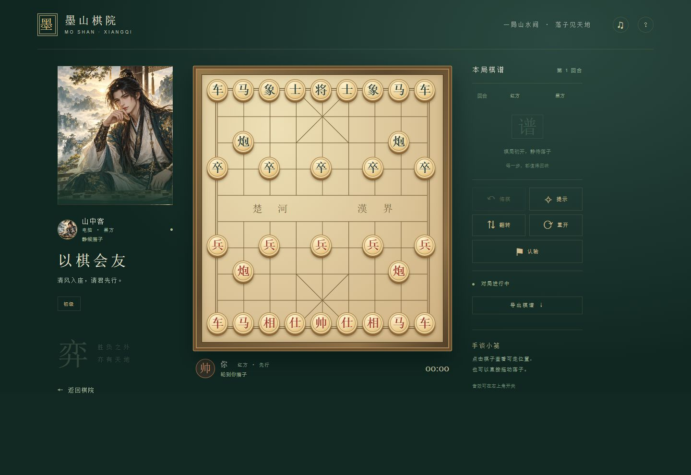

# 墨山棋院

中国风单页象棋人机对战。xiangqiground 0.1.0 + xiangqiops 1.0.10 + Pikafish WASM。

## 双击启动（Windows）

双击本文件夹下的 **启动游戏.cmd**，会启动仅本机可访问的网页服务，并用默认浏览器打开游戏。无需双击 index.html，也无需手动输入命令。本机已能使用 Codex 自带的 Node.js。

游戏期间保留启动器窗口；关闭窗口或按 Ctrl+C 即停止服务。重复启动会打开已有游戏地址。请保留同目录的 local-server.mjs 和 dist 文件夹。dist 已包含皮卡鱼与棋力网络，本地运行无需在线下载；菜单和对弈均可离线使用。复制到其他电脑时，需要 Node.js 22.13 或更高版本。

## 开发

Node.js 22.13+，`pnpm install`。生产构建：`pnpm build`。前端位于 dist/client，联机服务位于 dist/server；线上部署需支持 Cloudflare Worker 与 D1，不能只上传静态目录。

本地预览：构建后双击启动器，或执行 `node local-server.mjs --no-open`。默认在人机与残局模式本机运算，联机房间连接线上公共棋院；开发测试可在地址后添加 `?localRooms=1`，使用本地 SQLite 房间服务。个人对局数据库位于忽略的 .moshan-data/，不上传 GitHub。

## 在线双人对弈

从主菜单选择“与友对弈”，创建房间后复制邀请链接或八位邀请码。另一位棋友通过链接或邀请码加入。落子由服务端验证与持久保存；刷新后从房间页“继续上次房间”恢复。仅知道邀请码可以占据空位，入席后凭独立凭证走棋，第三人不能加入满员房间。邀请只含房间号，不包含入席凭证。

结束后双方点击“再来一局”才会开始新局，并交换红黑。联机模式不提供电脑提示或单方悔棋。离开会关闭房间；房间在最后操作后 48 小时过期。

## 残局研究与特效

内置真实《适情雅趣》具名古谱残局 150 局，可按名称、原谱局号搜索，对抗电脑并无限悔棋、重新研究。每局保留来源链接，来源、许可及筛选说明见 [public/endgames-sources.md](public/endgames-sources.md)。这里只提供原始局面，不把有限深度的电脑走法当作古谱唯一解。

右上角“棋院设置”分别控制吃子光环、将军印记和对局音效，偏好保存在本机。系统减少动态效果偏好亦受支持。

本地开发已配置 COOP/COEP。静态部署包含 `_headers` 和 isolation-sw.js；不识别 `_headers` 的主机首次使用引擎会自动刷新一次以启用隔离，再点击继续上局。引擎下载约 51 MB，需支持 SharedArrayBuffer 的现代浏览器。服务端无对局计算。

七档棋力：新手、入门、初级、进阶、高手、大师、宗师（原五档搜索深度保持 2 / 5 / 8 / 11 / 14）；执红执黑、悔棋、提示、翻转、认输、重新开局、棋谱导出、自动保存和独立音效。界面支持手机与桌面。

主菜单的脚本与样式内联在 HTML 中，字体使用设备宋体，不依赖 Google 字体服务。棋力引擎仅在需要走棋时下载，并显示进度。

棋局采用休闲规则：困毙判负、三次重复局面判和、六十回合无吃子判和；未实现正式比赛的长将长捉仲裁。棋谱使用常规中文步法，同行同类棋子的前后标记以导出的 UCI 坐标为准。

新手档使用简单吃子判断并经常出现随手棋；入门档加入对下一步丢子的考虑并减少随手棋。两个档位只走合法棋，未做真人胜率标定。旧存档按稳定难度标识迁移，原五档棋力保持不变。

## 验证

`pnpm test` 验证规则和坐标适配。tests/engine-smoke.mjs 与 tests/ui-smoke.mjs 用 Playwright + 本机 Edge 验证真实引擎、深度14、取消、实际落子、悔棋和移动端布局；运行前需要调整 Playwright 导入路径。

## 来源与许可

网页代码 GPL-3.0-or-later，详见 LICENSE。依赖来源与许可证见 public/licenses；引擎对应源码、构建材料、散列和网络许可见 public/engine/README.md。NNUE 网络附带非商业使用限制，商业使用应取得权利方许可。网页内提供源码包下载。

插画使用内置 ImageGen 生成，保存为 public/scholar.png。最终提示词：Create a refined cinematic Chinese ink painting game illustration, landscape 1536x1024. A handsome young adult Chinese male scholar swordsman with long black hair tied in a topknot, ivory and dark teal silk hanfu with subtle gold embroidery, sitting calmly behind a low table in a misty ancient mountain pavilion, thoughtful inviting expression, one hand holding a round wooden xiangqi piece. Character occupies right half, left half atmospheric empty dark teal mountains and pale mist for overlaid text. Jade mountains, ancient pine branches, delicate warm gold sunlight, painterly luxurious Chinese fantasy game art, restrained elegant muted teal, charcoal, ivory, antique gold palette. No text, no typography, no logos. Detailed beautiful face and hands, polished premium artwork.

## 界面预览

